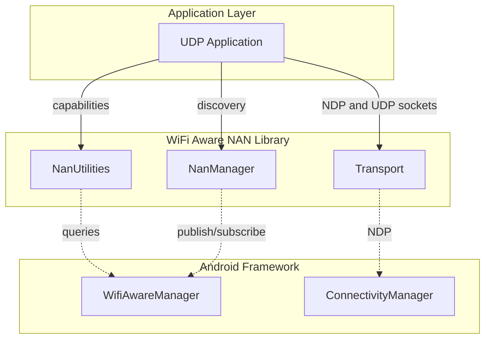

# WiFi Aware NAN Library - UDP Socket Example

## Overview

This document demonstrates how to use the WiFi Aware NAN library for discovering and communicating with a UDP Socket peer. The library simplifies WiFi Aware development by providing service discovery, NAN Data Path (NDP) establishment, and socket management.

### Architecture



## Steps to use UDP Socket Example

### Step 1: Device Capability Check

Check if the device supports WiFi Aware and display its capabilities.

```java
// Check if device supports WiFi Aware
NanUtilities capabilities = new NanUtilities();
if (capabilities.refreshCapabilities(wifiAwareSession)) {
    String info = capabilities.displayCapabilities();
    // Display to user
}
```

### Step 2: Service Discovery

Discover the UDP service using `NanManager`.

```java
NanManager nanManager = new NanManager(wifiAwareSession);

NanManager.DiscoveryListener listener = new NanManager.DiscoveryListener() {
    @Override
    public void onServiceFound(NanServiceInfo service) {
        // Store discovered UDP service for later connection
    }

    @Override
    public void onDiscoveryStarted(String serviceType) {
        // Discovery started
    }
    // ... implement other methods
};

// Discover UDP service
nanManager.discoverServices("ESP-Demo._udp", NanManager.PROTOCOL_NAN, listener);
```

### Step 3: Connect and Communicate over UDP

Establish the NAN Data Path (NDP) and communicate with the discovered peer using UDP.

```java
// Connect to a discovered peer
Transport transport = new Transport(context);
DiscoveredService service = /* from discovery callback */;

// Send SRV request
transport.sendSrvRequest(
    discover.getSession(),
    service.peerHandle,
    new TransportCallback() {
        @Override
        public void onConnected(Socket socket, Inet6Address peerIpv6) {
            // Use transport and peerIpv6 for UDP communication
        }

        @Override
        public void onError(String error) {
            // Handle error
        }

        @Override
        public void onDisconnected() {
            // Handle disconnect
        }
    }
);
```

### Step 4: Cleanup

Ensure that you release resources when the communication is done.

```java
// Cleanup when done
transport.release();
```

## ESP32 Setup

For the ESP32 side, this Android app is designed to work with the examples provided in the official Espressif WiFi apps repository.

1. Clone the repository: `https://github.com/espressif/esp-wifi-apps/`
2. Flash the `udp_server` example onto your ESP32 device.
3. Ensure the ESP32 is powered on and advertising its WiFi Aware (NAN) service before attempting to connect from the Android app.

## Command Line Interface (CLI)

The library provides a broadcast receiver (`AdbAutomationService`) that enables automation and testing via Android Debug Bridge (ADB).

### 1. Start Discovery
Starts scanning for UDP servers.
```bash
adb shell am broadcast -a com.library.nan.START_DISCOVERY \
    --es service_type "ESP-Demo" \
    --es protocol "UDP"
```

### 2. Query Peers
Lists all discovered peers and their properties in logcat.
```bash
adb shell am broadcast -a com.library.nan.QUERY_PEERS
```

### 3. Connect to Peer
Connects to a specific discovered instance by name.
```bash
adb shell am broadcast -a com.library.nan.CONNECT_PEER \
    --es instance_name "ESP UDP Server"
```

### 4. Send UDP Message
Sends a string message to the connected peer over UDP.
```bash
adb shell am broadcast -a com.library.nan.SEND_MESSAGE \
    --es message "Hello from ADB"
```

### 5. Disconnect
Disconnects from the peer and stops any active connection.
```bash
adb shell am broadcast -a com.library.nan.DISCONNECT
```
