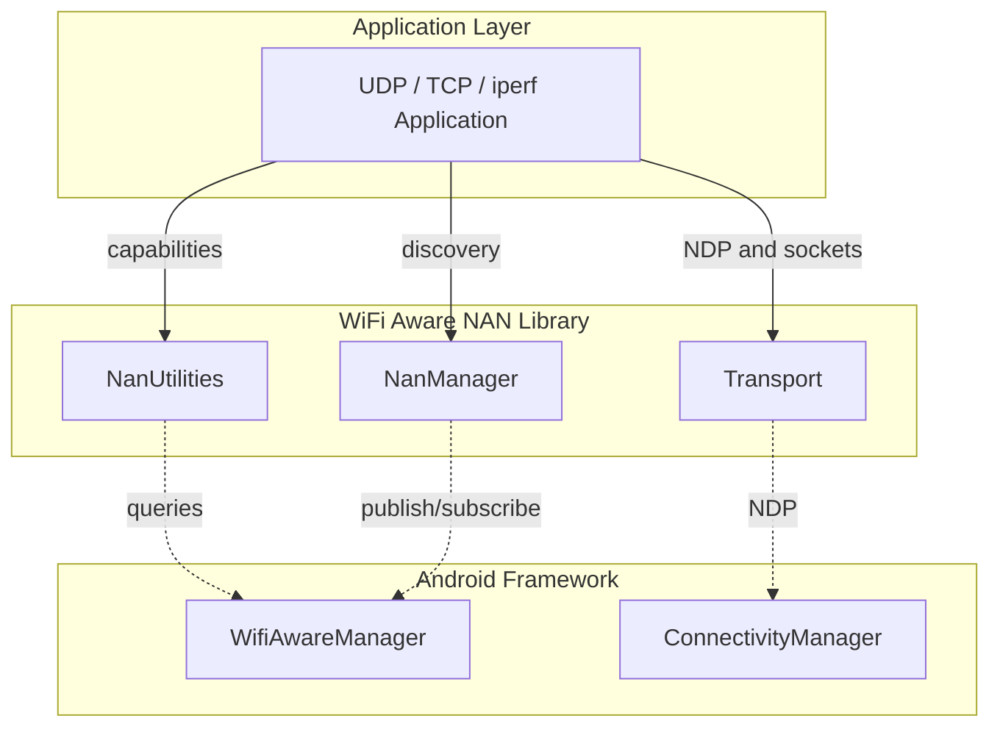

# Wi-Fi Aware Android Demo

## Overview

This demo discovers an Espressif Wi-Fi Aware (NAN) service, establishes the NAN
datapath, and lets you benchmark or exchange data with the peer. The connected
screen provides separate UDP, TCP, and iperf actions.

### Architecture



## Running the demo

### 1. Prepare the ESP peer

Build and flash the matching example from `esp-wifi-apps`:

- `udp_server` for UDP message testing
- `tcp_server` for TCP message testing
- `iperf_server` for benchmarking

For the iperf example, the default service is `ESP-iperf`, the default port is
`5001`, and the default test duration is 30 seconds. The Android service type
and protocol must match the ESP configuration.

### 2. Discover and establish the datapath

1. Enter the advertised service type (`ESP-iperf` for iperf).
2. Select `UDP` or `TCP`.
3. Enable **Secure Connection** and enter the ESP passphrase when using the
   passphrase-secured Android preset. Disable it for an open ESP build.
4. Tap **Discover**, then select the ESP service.
5. Wait for **Connected**. No application data is sent automatically when the
   NAN datapath is established.

### 3. Use the connected actions

- **Send UDP** sends one text datagram.
- **Send TCP** opens a TCP socket and sends one text line.
- **Run iperf** sends traffic for 30 seconds and reports bandwidth every
  3 seconds. The UDP benchmark is equivalent to:

  ```text
  iperf -c <peer> -p 5001 -t 30 -i 3 -u
  ```

  For TCP, omit `-u`. The Android app generates the traffic itself; it does
  not require an `iperf` binary on the phone. The ESP iperf server reports the
  receive-side measurement.

## Architecture

`NanManager` handles service discovery, `Transport` establishes the secured or
open NAN datapath, and `WifiAwareUdpClient` owns the UDP/TCP/iperf traffic
actions. The app uses IPv6 link-local addresses over the NAN network.

## Command Line Interface (CLI)

The `AdbAutomationService` receiver supports discovery, connection, TCP, and iperf commands:

```bash
adb shell am broadcast -a com.example.esp_wifi_demo.START_DISCOVERY \
    --es service_type "ESP-iperf" \
    --es protocol "UDP"

adb shell am broadcast -a com.example.esp_wifi_demo.QUERY_PEERS

adb shell am broadcast -a com.example.esp_wifi_demo.CONNECT_PEER \
    --es instance_name "ESP iperf Server"

adb shell am broadcast -a com.example.esp_wifi_demo.SEND_MESSAGE \
    --es message "Hello from ADB"

adb shell am broadcast -a com.example.esp_wifi_demo.SEND_TCP \
    --es message "Hello from ADB"

adb shell am broadcast -a com.example.esp_wifi_demo.RUN_IPERF

adb shell am broadcast -a com.example.esp_wifi_demo.DISCONNECT
```
